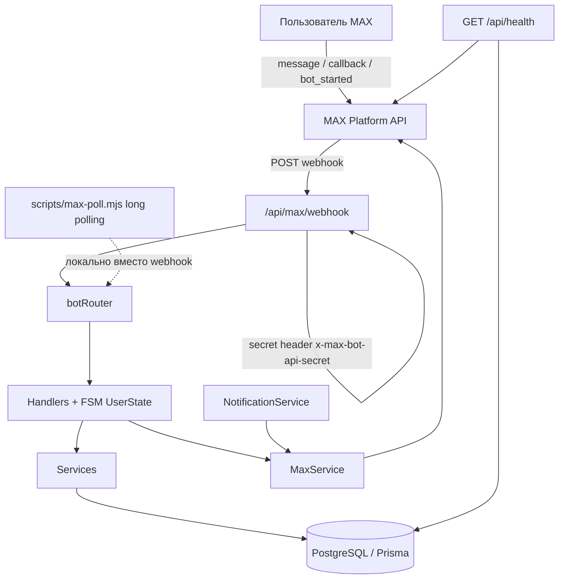
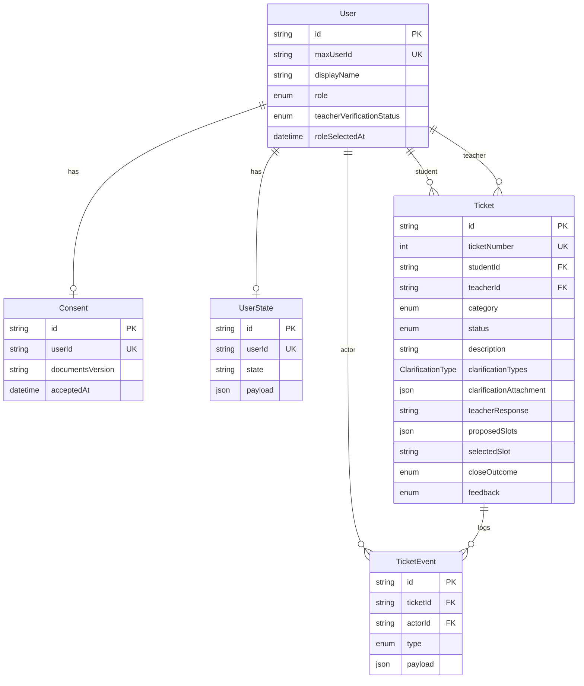

# MAX Consultation Tickets (max-hack)

Бот тикетов консультаций студентов с преподавателями для мессенджера MAX: согласие на обработку данных, роли, создание обращений с поиском похожих решённых вопросов, очередь преподавателя, уточнения (включая скриншоты), ответы, слоты консультаций, закрытие с итогом, обратная связь и метрики. Веб-интерфейс сведён к служебной странице; основной UX — диалог с ботом `@spring_cat4_bot`.

## Паспорт проекта

| Поле | Значение |
|------|----------|
| **Название** | `max-hack` / MAX Consultation Tickets (репозиторий GitHub: `MAXhack`) |
| **Тип** | Хакатон (платформа MAX). В текстах бота указан разработчик: команда «Телеграм» от РТУ МИРЭА (`src/bot/texts/legal.js`, `src/bot/texts/help.js`). Отдельного файла ТЗ или брифа в репозитории нет. |
| **Роль автора** | По `git shortlog` все 17 коммитов сделаны одним автором (`odkiii`): бот (handlers/FSM/keyboards), backend (Next.js API routes + Prisma-сервисы), схема БД и миграции, скрипты webhook/seed, деплой-конфиг Vercel. Отдельного UI-дизайнера, аналитика или команды в git не зафиксировано. |
| **Сроки** | Первый коммит `484c25a` — **2026-05-20**; последний `130e945` — **2026-05-28**. **17 коммитов** на ветке `main` (единственная ветка в remote). Активная доработка в основном 20–25 и особенно 28 мая (день демо). |
| **Статус** | **Демо / хакатон-сдача.** Последний коммит называется «апдейд для демо». Homepage репозитория указывает на `https://max-hack-beta.vercel.app`, но на момент проверки README деплой отвечает `DEPLOYMENT_NOT_FOUND` (404) — живой продакшен в штате не зафиксирован. |
| **Ссылки** | GitHub: https://github.com/odkiii/MAXhack · Homepage (заявлена): https://max-hack-beta.vercel.app · Бот: `@spring_cat4_bot` (упомянут в `src/app/page.js` и старом README в коммите `b90e1da`) · API webhook: `POST /api/max/webhook` · Health: `GET /api/health` |
| **Стек (версии из `package-lock.json`)** | Next.js **16.2.6**, React / React DOM **19.2.4**, Prisma / `@prisma/client` **6.19.3**, PostgreSQL (через Prisma), Tailwind CSS **4.3.0**, ESLint **9.39.4** + `eslint-config-next` **16.2.6**, axios **1.16.1**, dotenv **17.4.2**, uuid **14.0.0**, zod **4.4.3**. В коде `src/` импортов `axios` / `uuid` / `zod` нет — зависимости объявлены в `package.json`, но прикладного использования не видно. HTTP к MAX API идёт через нативный `fetch` в `src/lib/max-api.js`. |
| **Инфраструктура** | **Vercel** (`vercel.json`, build: `npm run build` = `prisma generate && prisma migrate deploy && next build --webpack`). **Neon** (или аналог облачного Postgres) — по смыслу коммита `b90e1da` «добавление vercel https + neon database для теста»; в репо нет docker-compose и Dockerfile. Redis / Firebase / Nginx / CI (`.github`) — **не зафиксировано в репо**. |

## Задача и контекст

Проект существовал как хакатонное решение для платформы MAX: сервис приёма обращений студентов к преподавателям с жизненным циклом тикета (создание → работа → уточнения / ответ / консультация → закрытие → оценка).

**Чья боль.** Студенту нужно задать вопрос преподавателю и получить статус; преподавателю — очередь и инструменты ответа; администратору — подтверждение роли преподавателя и метрики качества ответов. Формулировка из `SERVICE_INTRO` (`src/bot/texts/legal.js`): «приём обращений студентов к преподавателям, статусы, уточнения и история действий». В intro явно сказано, что это приложение разработчика, а не официальная функция MAX.

**Что было «на входе».** Отдельного ТЗ, PDF-брифа или issues в репозитории нет (`gh issue list` пуст, PR в remote нет). Ориентиры восстанавливаются из кода: роли STUDENT / TEACHER / ADMIN, каталог преподавателей РТУ МИРЭА в `src/bot/constants/categories.js`, категории обращений LAB/PROJECT/ACCESS/GRADING/RETAKE/OTHER, миграция `20260524120000_tz_full_flow` с полным потоком статусов и событий.

**Роли пользователей.**

| Роль | Как появляется | Что может |
|------|----------------|-----------|
| Студент | По умолчанию / выбор `role_student` | Создать обращение, смотреть свои тикеты, отвечать на уточнения, выбирать слот, оценивать ответ, удалять данные |
| Преподаватель | Каталог `TEACHERS` (мок-id) или запрос верификации → approve админом | Очередь NEW, активные/закрытые, принять, уточнить, ответить, закрыть с итогом, метрики |
| Админ | `ADMIN_MAX_USER_ID` или `role === ADMIN` (`isAdmin` в `src/bot/helpers/admin.helper.js`) | Подтверждение/отклонение преподавателей, метрики по преподавателям |
| MODERATOR | Enum в Prisma и ветка в `resolveMenuRole` | Отдельного меню/хендлеров нет — роль зарезервирована, поведения почти нет |

**Что считалось сдачей.** По git: итерации до «апдейд для демо» (`130e945`), seed истории Q&A для демо поиска похожих вопросов, деплой на Vercel + webhook MAX. Формального чеклиста сдачи в репо нет.

## Путь разработки от начала до сдачи

Хронология по `git log` (даты Europe/Moscow, автор `odkiii`):

1. **2026-05-20 — scaffold и первый бот** (`484c25a` «начальный коммит»). Создан Next.js-проект, Prisma init-миграция `20260517210448_init` (User, Consent, UserState, Ticket; статусы OPEN/IN_PROGRESS/CLOSED/CANCELLED; категории ACADEMIC/TECHNICAL/CAREER/OTHER), webhook-заглушка `src/app/api/max/webhook/route.js`, базовые handlers (`start` / `message` / `callback`), клавиатуры consent/menu/ticket, FSM `ticketCreation.states.js` (WAITING_TEACHER → … → CONFIRMATION). `MAX_API_URL` в `.env.example` тогда был `https://botapi.max.ru`.

2. **2026-05-24 — реальный MAX API + Vercel + Neon** (`b90e1da`). Появились `src/lib/max-api.js`, `max-update.js`, `max-keyboard.js`, скрипты `scripts/max-me.mjs`, `max-poll.mjs`, `max-webhook.mjs`, `vercel.json`. Расширен README с инструкцией деплоя. Webhook стал нормализовать update’ы и вызывать `botRouter`. Цель: публичный HTTPS без ngrok для теста бота.

3. **2026-05-25 — мелочь сборки** (`d9b8899`). Правка `package.json` (одна строка) — подготовка к билду/скриптам.

4. **2026-05-28 утро — полный ТЗ-флоу** (`6b02a2c`). Крупный коммит: миграция `20260524120000_tz_full_flow` (новые статусы NEW/AWAITING_CLARIFICATION/SCHEDULED, CloseOutcome, feedback, ClarificationType, TicketEvent, роль MODERATOR, перекат категорий на LAB/…). Разделение callback-хендлеров на `student.callback.handler.js` и `teacher.callback.handler.js`, FSM перенесён в `user.states.js`, тексты legal/help, `GET /api/health`, `NotificationService`, `TicketEventService`. Исправлены баги старта.

5. **Тот же день — смена user flow: похожий вопрос → преподаватели** (`f483654`). В `TicketService` добавлены `findSimilarClosedTicket` и `recommendTeachersByQuestion` (token overlap по закрытым тикетам). Миграция `teacher_verification_flow`. Онбординг ролей и запрос подтверждения преподавателя. Сценарий создания: сначала показать похожий решённый вопрос, потом рекомендации преподавателей.

6. **Сиды преподавателей и Q&A** (`48b2210`, `30bf41f`). Каталог из 8 преподавателей в `categories.js`. `scripts/seed-history.mjs` + огромный `seed-bulk-qa.mjs` (~240 bulk-вопросов) для демо поиска похожих. Мок-`maxUserId` вида `teacher_grosheva` (не числовые id MAX).

7. **Админка и UX сообщений** (`3368ec0`, `4b9b153`). Удаление предыдущего сообщения при ответе на callback (`MaxService.replyFromCallback` / `deleteMessage`), кнопки approve/reject преподавателей для админа (`admin.helper.js`). Кнопка «Главное меню», пагинация списка преподавателей (`teacher-selection.helper.js`, `tpage_*`).

8. **Фиксация роли и формат тикета** (`99a7703`, `9132068`). Поле `roleSelectedAt` + `onboarding.helper.js` (не спрашивать роль повторно). Удалён `Ticket.title` (миграция `drop_ticket_title`), карточки через `ticket-format.js`.

9. **Навигация «Назад», метрики, статусы в UI** (`a2c8c9b`, `6e76aa4`, `7df6c4c`). `NavigationService` + стек в `UserState.payload.navStack`. Feedback HELPFUL/NOT_HELPFUL после ответа преподавателя, админские метрики (`metrics.helper.js`). Эмодзи/лейблы статусов, префикс 🔔 у нотификаций, защита доставки на мок-id.

10. **Скриншоты в уточнениях** (`945809c`, `3a91354`). Поле `clarificationAttachment` (JSONB), `src/lib/max-media.js` (нормализация image/file/video, исходящие attachments по token/url). Кнопка «Смотреть скриншот» у преподавателя (`t_att_*`). Убраны дубликаты кнопок навигации.

11. **Финиш под демо** (`130e945`). В `canDeliverMaxNotification` — не слать MAX API на нечисловые mock teacher id; правки `NotificationService`. Это «коммит сдачи/демо»: защита от шума ошибок при сидах.

Итого итераций по смыслу: scaffold → интеграция MAX/Vercel → полный lifecycle → поиск похожих + верификация → сиды → UX/админ → метрики/медиа → демо-hardening.

## Архитектура

### Слои

```
Пользователь MAX
    → MAX Platform (webhook / long polling)
        → Next.js Route Handler  POST /api/max/webhook
            → normalizeUpdate (src/lib/max-update.js)
            → botRouter (src/bot/router.js)
                → handlers (start / message / callback → student|teacher|admin)
                    → helpers + keyboards (UI бота)
                    → services (Ticket, User, State, Consent, Notification, …)
                        → Prisma Client → PostgreSQL (Neon в облаке)
                → MaxService / max-api.js → platform-api.max.ru
```

Отдельного «REST API для фронта» почти нет: два HTTP-эндпоинта — webhook и health. «Фронтенд» — inline/message-кнопки MAX и FSM-диалоги.

### Процессы / контейнеры

- **Vercel serverless** — Next.js app, Node runtime на webhook (`export const runtime = "nodejs"`).
- **PostgreSQL** — внешняя БД (`DATABASE_URL`); на билде выполняется `prisma migrate deploy`.
- **Локально** — `next dev --webpack` + опционально `npm run max:poll` вместо webhook.
- Docker-контейнеров в репо **нет**.

### Mermaid: потоки



### Что ходит куда

| Канал | Назначение |
|-------|------------|
| `POST /api/max/webhook` | Входящие update’ы MAX; проверка `MAX_WEBHOOK_SECRET` через заголовок `x-max-bot-api-secret` |
| `GET /api/health` | `SELECT 1` + `GET /me` бота |
| `GET /` (`src/app/page.js`) | Статическая служебная страница с именем бота и путём webhook |
| Исходящие MAX | `POST /messages`, `POST /answers`, `DELETE /messages`, подписки `/subscriptions`, `GET /me`, `GET /updates` |
| Очереди / cron / Redis | **Не зафиксировано в репо** |

## Frontend — что и как сделано

Настоящего SPA с роутером страниц нет. UI — **диалоговый бот MAX** + минимальная Next.js-страница.

### Экраны / клавиатуры и зачем

| Экран / клавиатура | Файл | Зачем |
|--------------------|------|-------|
| Согласие | `consent.keyboard.js` + `legal.js` | Первый вход: принять условия / показать intro |
| Выбор роли | `role.keyboard.js` | Студент / запрос преподавателя / ожидание approve |
| Меню студента | `menu.keyboard.js` | Создать обращение, мои обращения, помощь, удаление данных (+ админ-кнопки) |
| Меню преподавателя | `teacher.menu.keyboard.js` | Очередь, активные, закрытые, диагностика, метрики |
| Похожий вопрос | `getSimilarDecisionKeyboard` | «Помогло» / «Создать тикет» |
| Рекомендации и выбор преподавателя | `ticket.keyboard.js`, `teacher-selection.keyboard.js` | Топ-3 по overlap или пагинированный список из БД |
| Категория / подтверждение | `ticket.keyboard.js` | LAB…OTHER + confirm с предупреждением о PII |
| Действия по тикету студента | `getStudentTicketActionsKeyboard` | Просмотр, уточнение, слоты, закрытие |
| Feedback | `feedback.keyboard.js` | Полезно / не полезно |
| Тикет преподавателя | `teacher.ticket.keyboard.js` | Accept, clarify types, reply, close outcomes, смотреть вложение |
| Метрики админа | `metrics.keyboard.js` | Список преподавателей с пагинацией |

### Стейт

FSM в PostgreSQL-таблице `UserState` (`StateService`): строка `state` + JSON `payload` (черновик вопроса, ticketId, selectedTypes, **navStack** для «Назад»). Состояния перечислены в `src/bot/states/user.states.js` (IDLE, WAITING_QUESTION_INPUT, WAITING_SIMILAR_DECISION, WAITING_TEACHER, … WAITING_CONSULTATION_SLOTS и др.). Redux/Vue/Zustand **не используются**.

### Формы, валидация, пустые состояния

Валидация — в handlers: пустой текст → «отправьте одним сообщением»; для скриншота — обязателен attachment (`pickIncomingMedia`); слоты — разбор строки по `;`; категории — `isValidTicketCategory`. Пустые списки: «У вас пока нет обращений», «Очередь пуста», «Нет ожидающих запросов». Ошибки webhook: пользователю уходит текст «Произошла ошибка… /start» (`webhook/route.js`).

### Авторизация на клиенте

OAuth веб-логина нет. Идентификация — `maxUserId` из update MAX; админ — сравнение с `ADMIN_MAX_USER_ID`; преподаватели из каталога автоматически получают `role=TEACHER` + `APPROVED` в `UserService.findOrCreate`.

### Адаптив / Mini App / SSR

Mini App MAX и отдельный адаптивный веб-UI **не реализованы**. Страница `src/app/page.js` — центрированный текст на Tailwind; `layout.js` подключает шрифты Geist. SSR для бота не релевантен: логика в Route Handlers.

### Ключевой сценарий студента (шаг за шагом)

1. `/start` или `bot_started` → consent, если нет записи в `Consent`.
2. Выбор роли (если нет `roleSelectedAt`).
3. «Создать обращение» → текст вопроса → поиск похожего CLOSED-тикета.
4. Если похожий найден — показать Q&A; «Помогло» завершает без тикета; «Создать тикет» → рекомендации преподавателей / ручной выбор.
5. Категория → подтверждение (с `PII_WARNING`) → `TicketService.create` → уведомление преподавателю.
6. При уточнении — текст и/или скриншот → статус снова IN_PROGRESS.
7. После ответа преподавателя — кнопки feedback; оценка может закрыть тикет как RESOLVED.
8. «Удаление данных» → `UserDataService.deleteAllUserData` (тикеты студента, state, consent, user).

Сценарий преподавателя: очередь → принять → (опционально уточнение один раз) → ответить текстом → закрыть с итогом RESOLVED/REDIRECTED/REJECTED/CONSULTATION_SCHEDULED (слоты через `;`).

## Backend — что и как сделано

### HTTP-эндпоинты

| Метод | Путь | Вход | Выход | Зачем |
|-------|------|------|-------|-------|
| `POST` | `/api/max/webhook` | JSON update MAX; опц. `x-max-bot-api-secret` | `{ ok: true/false }` | Единственная точка входа бота |
| `HEAD` | `/api/max/webhook` | — | 200 | Проверка доступности |
| `GET` | `/api/health` | — | JSON checks (db, bot, token flags) | Диагностика деплоя |
| `GET` | `/` | — | HTML | Служебная витрина |

### Команды / callback-префиксы (логика бота)

| Действие | Где | Смысл |
|----------|-----|-------|
| `/start`, `bot_started` | `start.handler.js` | Онбординг |
| `accept_consent`, `show_legal` | student callback | Согласие |
| `role_student`, `role_teacher`, `request_teacher_verification` | student | Роли |
| `create_ticket`, `similar_*`, `rec_teacher_*`, `pick_teacher_*`, `tpage_*`, `cat_*`, `confirm_ticket` | student | Создание |
| `my_tickets`, `st_view_*`, `st_clarify_*`, `st_slots_*`, `st_slot_*`, `st_close_*`, `fb_yes_*` / `fb_no_*` | student | Жизнь тикета |
| `delete_data`, `delete_confirm` | student | GDPR-подобное удаление |
| `t_queue`, `t_active`, `t_closed`, `t_view_*`, `t_accept_*`, `t_clarify_*`, `t_clt_*`, `t_reply_*`, `t_close_*`, `t_co_*`, `t_finalize_*`, `t_att_*`, `t_metrics`, `t_diag` | teacher | Работа преподавателя |
| `admin_pending_teachers`, `admin_verify_*`, `admin_reject_*`, `admin_teacher_metrics`, `admin_mpage_*`, `admin_mview_*` | callback.handler | Админ |
| `nav_back`, `main_menu` | navigation | Навигация |

Текстовые кнопки меню (type `message`) резолвятся через `menu-text.js` → `menu-actions.helper.js`.

### Бизнес-правила

- Статусы: NEW → IN_PROGRESS → AWAITING_CLARIFICATION / SCHEDULED / CLOSED (и CANCELLED в enum, активного сценария отмены в handlers почти нет).
- Уточнение запрашивается один раз (`hasClarificationBeenRequested`).
- Похожий тикет: score token overlap ≥ 2 по последним 200 CLOSED.
- Рекомендации преподавателей: сумма score по CLOSED с teacherId; fallback — топ по числу закрытых среди каталога `TEACHERS`.
- Мок-преподаватели с нечисловым `maxUserId` не получают push (`canDeliverMaxNotification`).
- Feedback: при оценке незакрытого тикета с `teacherResponse` — закрытие RESOLVED + событие FEEDBACK_LEFT.
- События пишутся в `TicketEvent` через `TicketEventService.log` (CREATED, ACCEPTED, …). Тип `REASSIGNED` в enum есть, переназначения в коде **не найдено**.

### Интеграции

**MAX Bot API** (`https://platform-api.max.ru`, переопределяется `MAX_API_URL`): Authorization = токен или `Bearer` при `MAX_USE_BEARER=1`. Подписка webhook: `npm run max:webhook`. Long polling: `npm run max:poll`. Медиа уточнений хранятся как JSON `{ type, token, url }` и переотправляются по token.

Других внешних API (Telegram, NASA, Stockfish, Firebase и т.п.) в коде **нет**.

### Обработка ошибок

- Webhook: try/catch → лог → попытка уведомить пользователя → 500 JSON.
- `MaxService.sendMessage`: лог статуса/data; при 401 подсказка про `MAX_USE_BEARER`.
- `NotificationService`: ошибки отправки глотаются (return `{ ok: false }`), чтобы не ронять основной флоу.
- Ownership checks в `TicketService` (studentId/teacherId) → `null` и сообщение «не найдено / не удалось».

### Что сознательно не стали делать

- Нет Puppeteer / браузерной автоматизации.
- Нет отдельного админ-веб-кабинета.
- Нет полнотекстового поиска PostgreSQL (ILIKE/tsvector) — поиск похожих в памяти по выборке.
- Нет Docker, CI, автотестов.
- Нет реальных MAX user id преподавателей в каталоге (демо-строки) — доставка им отключена.

## База данных

### СУБД и почему

**PostgreSQL** через Prisma. Выбор типичен для Vercel + Neon (pooled connection string упоминался в README коммита `b90e1da`). Отдельного ADR в репо нет; альтернативы (SQLite/Mongo) не обсуждаются в файлах.

### Сущности и связи



### Поля, enum, индексы

Enums — в `prisma/schema.prisma`: Role, TeacherVerificationStatus, TicketStatus, TicketCategory, CloseOutcome, TicketFeedback, ClarificationType, TicketEventType.  
Уникальные индексы: `User.maxUserId`, `Consent.userId`, `UserState.userId`, `Ticket.ticketNumber`.  
На `TicketEvent.ticketId` — индекс из миграции `tz_full_flow`.  
JSONB: `UserState.payload`, `Ticket.proposedSlots`, `Ticket.clarificationAttachment`, `TicketEvent.payload`.  
Массив enum: `clarificationTypes ClarificationType[]`.

### Миграции по порядку

| Миграция | Зачем |
|----------|-------|
| `20260517210448_init` | Базовые User/Consent/UserState/Ticket |
| `20260524120000_tz_full_flow` | Полный lifecycle: статусы, категории, clarification/slots/feedback/events, MODERATOR |
| `20260528103000_teacher_verification_flow` | Статус верификации преподавателя на User |
| `20260528120000_role_selected_at` | `roleSelectedAt` + backfill из consent |
| `20260528130000_drop_ticket_title` | Убран title у тикета |
| `20260528140000_clarification_attachment` | JSONB вложение скриншота |

### Критичные запросы

- Upsert `UserState` / `Consent` по `userId`.
- `findOrCreate` User по `maxUserId`.
- Списки тикетов `where: { teacherId, status: NEW|… }`, `where: { studentId }`.
- Health: `prisma.$queryRaw\`SELECT 1\``.
- Поиск похожих: `findMany` CLOSED take 200/400 + JS scoring (не SQL ILIKE).
- `groupBy` статусов для диагностики преподавателя; `count` feedback для метрик.
- Seed: `createMany` батчами по 50.

### Что хранится не в SQL

Каталог преподавателей и экспертиза — **JS-константа** `TEACHERS` в `categories.js`. Тексты legal/help — файлы. Redis/Firestore/файловое хранилище сессий — **нет** (стейт в Postgres). Бинарники скриншотов в БД не кладутся — только token/url от MAX.

## Навыки, которые здесь применялись

### Frontend

| Навык | Где | Что сделано |
|-------|-----|-------------|
| Проектирование диалогового UX / FSM | `user.states.js`, handlers | Многошаговые сценарии с payload и очисткой state |
| Inline/message keyboards MAX | `src/bot/keyboards/*`, `max-keyboard.js` | Меню, пагинация, toggle типов уточнения, nav «Назад» |
| Обработка пустых/ошибочных состояний | student/teacher handlers | Явные тексты при пустой очереди, невалидном шаге |
| Минимальный Next.js App Router UI | `src/app/page.js`, `layout.js`, Tailwind 4 | Служебная витрина и metadata |
| Медиа в чате | `max-media.js` | Приём/повторная отправка image/file/video по token |

### Backend

| Навык | Где | Что сделано |
|-------|-----|-------------|
| Webhook API + секреты | `api/max/webhook/route.js` | Верификация secret, нормализация payload, 403/500 |
| Интеграция внешнего Bot API | `max-api.js`, `max.service.js`, scripts | messages/answers/subscriptions/updates/me |
| Доменный слой сервисов | `src/services/*` | Тикеты, события, нотификации, consent, users |
| Ролевая модель и верификация | `user.service.js`, `admin.helper.js` | STUDENT/TEACHER/ADMIN, PENDING→APPROVED |
| Поиск похожих без поискового движка | `ticket.service.js` | Нормализация токенов, stop-words, overlap score |
| Serverless Prisma | `prisma.js`, `package.json` build | generate + migrate deploy на Vercel, singleton client |
| Операционные скрипты | `scripts/max-*.mjs`, seed | Регистрация webhook, poll, наполнение демо-данных |

### Базы данных

| Навык | Где | Что сделано |
|-------|-----|-------------|
| Моделирование тикет-системы | `schema.prisma` | Связи student/teacher, audit events, enums статусов |
| Эволюция схемы миграциями | `prisma/migrations/*` | Init → full flow → verification → attachment |
| JSONB и массивы enum | Ticket / UserState | Слоты, вложения, FSM payload, navStack |
| Каскады и ownership | FK onDelete Cascade/SetNull + findFirst where teacherId | Безопасное удаление пользователя, изоляция тикетов |
| Сиды идемпотентные | `seed-history.mjs` | Dedup по teacherId+description, batch createMany |

## Принятые решения и компромиссы

1. **Next.js как host бота** — один деплой даёт HTTPS webhook на Vercel; ценой serverless cold start и необходимости pooled Neon.
2. **Prisma + PostgreSQL** — быстрая схема и migrate deploy в CI-like build; без raw SQL search.
3. **FSM в БД, не в памяти** — переживает рестарты serverless; payload раздувается (navStack).
4. **Каталог преподавателей в коде** с mock id — удобно для демо и seed, но push им не доставляется (`canDeliverMaxNotification`).
5. **Поиск похожих в JS по 200 тикетам** — достаточно для хакатона/демо seed; не масштабируется без индекса.
6. **Удаление предыдущего сообщения бота** при callback — чище чат, но хрупко к правам API delete.
7. **Один раз уточнение** — упрощение к сдаче; повторный clarify запрещён.
8. **Зависимости zod/uuid/axios** в package.json без использования в `src/` — технический долг / незавершённый план валидации.
9. **Скрипт `db:cleanup-mocks`** указан в `package.json`, файла `scripts/cleanup-mock-teachers.mjs` в репо **нет** — битая команда.
10. **Что бы переписать:** вынести поиск в Postgres FTS; реальные teacher maxUserId; e2e на webhook fixtures; убрать неиспользуемые deps; отдельный admin web или хотя бы тесты на TicketService.

## Что доведено до конца, что нет

| Область | Статус |
|---------|--------|
| Consent + старт + меню ролей | Работает в коде |
| Создание тикета, похожие Q&A, рекомендации | Работает (зависит от seed) |
| Очередь преподавателя, accept/reply/close/slots | Работает |
| Уточнения + скриншоты | Работает (`clarificationAttachment`) |
| Feedback и метрики | Работает (count HELPFUL/NOT_HELPFUL) |
| Админ verify/reject преподавателей | Работает при заданном `ADMIN_MAX_USER_ID` |
| Webhook + health + Vercel build pipeline | В коде есть |
| Деплой `max-hack-beta.vercel.app` | Homepage задан в GitHub; **сейчас 404 DEPLOYMENT_NOT_FOUND** — актуальная доступность не подтверждена |
| Сиды демо-истории | Есть (`npm run db:seed`) |
| Веб-UI тикетов | Только заглушка-витрина |
| Роль MODERATOR / статус CANCELLED / REASSIGNED | В схеме есть, полноценных сценариев нет |
| Автотесты | **Нет** |
| CI (GitHub Actions) | **Нет** |
| Docker | **Нет** |
| Issues / PR history | **Пусто** в remote |
| Секреты в git | `.env` в `.gitignore`; в репо только `.env.example` с плейсхолдерами — **ключей не закоммичено** (по текущему дереву) |
| `npm run db:cleanup-mocks` | Скрипт **отсутствует** |
| axios / zod / uuid | В dependencies, в приложении **не используются** |

## Как запустить

### Установка

```bash
npm install
# postinstall уже вызывает prisma generate
```

### Переменные окружения

Скопируйте `.env.example` → `.env`. Имена переменных (значения секретов в README не копируются):

| Переменная | Назначение |
|------------|------------|
| `DATABASE_URL` | PostgreSQL connection string |
| `MAX_BOT_TOKEN` | Токен бота MAX |
| `MAX_API_URL` | База API (по умолчанию `https://platform-api.max.ru`) |
| `MAX_WEBHOOK_URL` | Публичный URL webhook для `npm run max:webhook` |
| `MAX_WEBHOOK_SECRET` | Секрет подписки (A-Z a-z 0-9 `-`); тот же на Vercel |
| `ADMIN_MAX_USER_ID` | MAX user id администратора |
| `MAX_USE_BEARER` | Опционально `1`/`true` — Authorization Bearer (см. health hint) |
| `TEAM_NAME` | Опционально, подпись в legal-текстах |
| `VERCEL_URL` / `VERCEL_PROJECT_PRODUCTION_URL` | Подхватываются скриптом webhook на Vercel |

### Миграции и seed

```bash
npm run db:generate
npm run db:migrate          # prisma migrate dev
# или на проде/Vercel build: prisma migrate deploy (внутри npm run build)
npm run db:seed             # scripts/seed-history.mjs (+ bulk Q&A)
npm run db:studio           # просмотр БД
```

### Dev-сервер

```bash
npm run dev
```

Next.js поднимается на **порту 3000** по умолчанию (`http://localhost:3000`). Страница `/` — витрина; webhook локально MAX не примет по HTTP без туннеля.

### Webhook / poll

```bash
npm run max:me              # проверка токена /me
npm run max:webhook         # зарегистрировать подписку
npm run max:webhook:get
npm run max:webhook:delete -- https://your-domain/api/max/webhook
npm run max:poll            # long polling вместо webhook
```

Production webhook: `https://<host>/api/max/webhook`.  
Проверка: `GET https://<host>/api/health`.

### Docker

**Не зафиксировано в репо** — Dockerfile / docker-compose отсутствуют.

### Build

```bash
npm run build   # prisma generate && prisma migrate deploy && next build --webpack
npm start       # next start
```

## Артефакты для портфолио

### Bullet’ы для резюме (почти дословно)

- Разработал бота тикетов консультаций для мессенджера MAX на Next.js 16 + Prisma + PostgreSQL с деплоем на Vercel и webhook `POST /api/max/webhook`.
- Спроектировал доменную модель тикета (статусы, категории, уточнения, слоты, feedback, audit `TicketEvent`) и провёл серию Prisma-миграций от init до clarification attachments.
- Реализовал FSM диалогов в PostgreSQL (`UserState`) с разделением student/teacher/admin handlers и навигацией «Назад» через `navStack`.
- Сделал поиск похожих решённых вопросов и рекомендацию преподавателей на основе token-overlap по истории CLOSED-тикетов; подготовил seed из сотен Q&A для демо.
- Интегрировал MAX Bot API (messages, callback answers, subscriptions, media token/url) и защитил webhook секретом `x-max-bot-api-secret`.
- Добавил роли, верификацию преподавателей админом, метрики HELPFUL/NOT_HELPFUL и сценарий удаления пользовательских данных.
- Настроил health-check (`SELECT 1` + `/me`) и operational scripts (`max:webhook`, `max:poll`, `db:seed`) для отладки без ngrok через Vercel HTTPS.

### Истории с собеседования

1. **Проблема:** serverless на Vercel + локальный Postgres не работает для бота с телефона. **Что сделал:** вынес БД в Neon, добавил `vercel.json` и скрипт регистрации webhook (`b90e1da`). **Итог:** бот принимал update’ы по публичному HTTPS.
2. **Проблема:** студенты создают дубли вопросов, которые уже решали. **Что сделал:** изменил user flow — сначала `findSimilarClosedTicket`, потом преподаватели (`f483654`) + bulk seed. **Итог:** демо показывает «похожий вопрос уже решали» до создания тикета.
3. **Проблема:** уведомления сыпались ошибками на mock teacher id из сидов. **Что сделал:** `canDeliverMaxNotification` — только числовые MAX id (`130e945`). **Итог:** демо без шума 4xx от API.
4. **Проблема:** преподавателю нужен скриншот ошибки студента. **Что сделал:** JSONB `clarificationAttachment`, `max-media.js`, кнопка `t_att_*`. **Итог:** вложение переотправляется в чат преподавателя по token/url.
5. **Проблема:** повторный выбор роли на каждом `/start`. **Что сделал:** поле `roleSelectedAt` + `onboarding.helper.js`. **Итог:** роль фиксируется после первого выбора.

### Какие скриншоты стоит добавить

Не генерировать фейковые — снять из реального MAX-чата с `@spring_cat4_bot` (или из записи демо):

1. Экран согласия / выбора роли.
2. Ответ бота с похожим решённым вопросом и кнопками «Помогло» / «Создать тикет».
3. Карточка созданного тикета у студента и уведомление у преподавателя.
4. Очередь преподавателя и действия accept / clarify / reply.
5. Сообщение со скриншотом уточнения и кнопка «Смотреть скриншот».
6. Feedback «полезно/не полезно» и экран метрик.
7. (Опционально) `GET /api/health` JSON и витрина `https://…/`.

---

**Проверка полноты этого файла:** по нему можно ответить, что это за продукт, как устроены слои и потоки, какой вклад в git, какой стек с версиями, как шли коммиты от scaffold до демо, где «фронт» (клавиатуры/FSM), где бэкенд (webhook/services) и где БД (Prisma schema + миграции). Где факта нет — явно помечено «не зафиксировано в репо».
